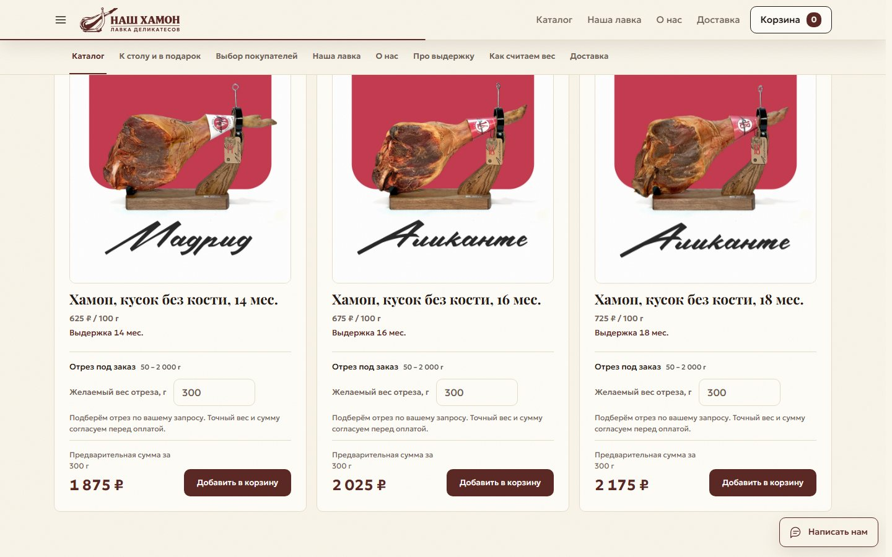

# Наш Хамон

Хамонная лавка при Сытном рынке, Санкт-Петербург. Репозиторий держит две витрины с одними данными и одним дизайн-системным контрактом: статическое демо для согласования и Next.js-приложение для боевого запуска. Это не два конкурирующих магазина и не черновик под переписывание.

**Сайт:** https://ssrjkk.github.io/our-jamon/

## Скриншоты

Сняты с опубликованного сайта в настоящем браузере (Chrome, 1440×900 и 390×844).

| Главная | Разделы |
| --- | --- |
|  |  |

<p align="center"></p>

## What this is

- **`index.html` (корень)** — демо-витрина, которую отдаёт GitHub Pages. Автономна: кириллические шрифты и GSAP лежат в `brand/`, внешних запросов ноль. Оформление заказа здесь помечено как симуляция: ни письма, ни оплаты, ни удара по 1С.
- **`shop/`** — Next.js 16: расчёт корзины на сервере, закрытые данные заказов, SQLite вместо JSON, подтверждение веса оператором, оплата через Т-Банк, выгрузка заказа в 1С:УНФ.

Две витрины, одна правда: каталог живёт в `shop/lib/catalog.json`, статика получает его той же выгрузкой через `npm run sync:static`, а гейт `catalog-parity` падает, если демо и движок разошлись в составе, порядке, ценах или артах.

## Checks

```
cd shop
npm run typecheck
npm test                 # unit: каталог, подпись Т-Банка, SQLite, деплой-гейты, арт карточек
SHOP_URL=http://127.0.0.1:3000 npm run build:standalone
npx playwright test      # e2e: обе витрины, 3 вьюпорта, доступность, путь покупателя; сам пересобирает standalone
```

## Release gates in CI

`ci.yml` прогоняет тот же набор на каждом пуше в `main` и в каждом PR: `gates` (typecheck + unit), `build` (standalone с `SHOP_URL` и `verify-build`), `e2e` (Playwright), `docker` (образ и опрос `/api/health`). Имена задач — ASCII и обязательны: переименовать задачу значит молча снять защиту ветки.

`main` закрыта ruleset-ом: без force-push, изменения только через PR, все четыре проверки зелёные, ветку не удалить. Обязательного одобрения ревью нет: проект ведёт один мейнтейнер. В публикацию попадает только уже проверенный коммит.

## What gets published to Pages

`pages.yml` публикует не репозиторий, а собранный список: `node shop/scripts/build-pages-artifact.mjs` кладёт в `demo-dist/` ровно витрину — `index.html`, `404.html`, `robots.txt` и каталоги `brand/` и `img/`. Гейт `pages-surface` сверяет артефакт со скриптом: без `.ts`, `.md`, `.zip` и `.sqlite` на публичном адресе, опубликованные страницы побайтово равны файлам из git, каждый названный в разметке ассет на месте и непустой.

Демо закрыто от поисковика (`noindex` плюс `Disallow: /`), пока цены не подтверждены. Открыть — значит поменять гейт в том же коммите: закрытая витрина не может открыться молча.

## Repo

- `shop/lib/catalog.json` — единственный источник коммерческих данных. Строится из строк прайса (`scripts/price-0711.rows.json`, выгрузка 1С:УНФ «Прайс 0711») командой `node scripts/build-catalog.mjs`; правки — в скрипте, не в JSON руками.
- `shop/scripts/` — `build-catalog.mjs` (прайс → каталог), `sync-static.mjs` (каталог → `index.html`), `brand-variants.mjs` (варианты артов под измеренные слоты), `build-pages-artifact.mjs` (что уходит на Pages), `verify-build.mjs` (боевой адрес в собранном выводе), `pack-standalone.mjs`.
- Токены и правила витрин живут в CSS обеих поверхностей (`:root` в `index.html` и `shop/app/globals.css`), а не в отдельном документе: их сверяет гейт `design-tokens`, и расхождение между витринами — падение, а не замечание.
- `shop/AGENTS.md` — правила работы с движком для тех, кто его правит.
- `RELEASE.md` — релизный статус, путь боевого запуска и список блокеров. Секреты не хранятся в репозитории и не пишутся в документацию: ключи живут в `shop/.env`, который исключён `shop/.gitignore` и `.dockerignore`.
- Приватное (`_brand/`, брендбук, архивы сессии, фото поставщика) исключено из публикации; гейт `privacy` сверяет индекс git, а не диск.

## Статус

| Поверхность | Статус |
|---|---|
| Демо-витрина (Pages) | 🟢 работает, релиз-кандидат |
| Движок магазина | 🟡 код готов, ждёт хостинг и боевые ключи |
| Розничные цены | 🔴 27 позиций уточняются у лавки |
| Оплата, 1С, реквизиты | 🟡 код и контракт есть, боевых ключей нет |

## По-русски

Итог для заказчика: демо на Pages — это согласованная витрина, готовая к показу. Магазин с оплатой и 1С готов на уровне кода и гейтов; для боевого запуска не хватает данных лавки (розничные цены, порог бесплатной доставки, фото и видео) и боевых ключей (Т-Банк, 1С, адрес и хостинг, пароль админки). Полный список и порядок действий — в `RELEASE.md`.

Публикация проверяется кодом, а не вкусом: перед каждым релизом гоняются `npm run typecheck`, `npm test`, `npm run build` и Playwright. Гейты держат токены, паритет каталогов, арт карточек, типографику (без латинских омоглиф, неразрывные единицы, тире между словами), приватность (фото поставщика не попадают в git), подпись платежа, SQLite и деплой-контракт.

Реквизиты продавца лежат в футере обеих витрин и сверены гейтом `checkout`: ИНН и ОГРНИП обязательны, а телефон и адрес лавки — нет, потому что это данные лавки, а не ИП, и их отсутствие не повод ничего не изобретать.

Контакты: Сытнинская ул., 4П, фуд-аллея рынка «Сытный»; вт–вс 10:30–20:30; +7 (906) 896-00-99; 619896@mail.ru.

## Документация

- [Releases](RELEASE.md)
- [Shop guide](shop/README.md)
