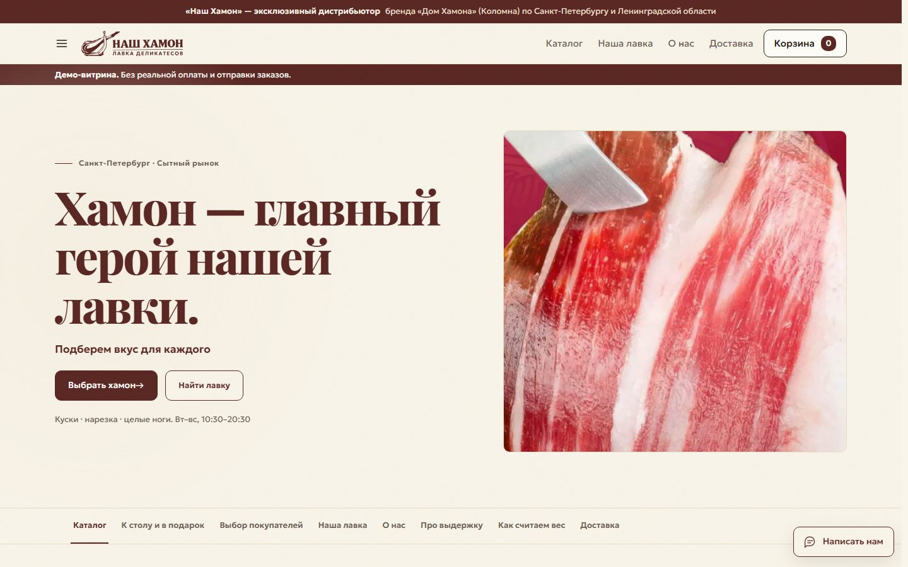

# Our Jamon

> **Languages:** [English](README.md) · [Русский](README.ru.md)

Two storefront surfaces for Nash Hamon with one catalog and one design contract:
a static demo for review and a Next.js application for a live store. The full
Russian documentation is in [README.ru.md](README.ru.md).

**Site:** https://ssrjkk.github.io/our-jamon/  
**Source:** https://github.com/ssrjkk/our-jamon

## Screenshot



The published site is a demo. Ordering is simulated; email, payment and 1C are not
connected to live credentials.

## Surfaces

- Root `index.html` — autonomous GitHub Pages demo with local fonts and GSAP.
- `shop/` — Next.js 16 storefront with server-side cart calculations, SQLite orders,
  operator-confirmed weight, T-Bank payment contract and 1C export code.

`shop/lib/catalog.json` is the commercial source of truth. `npm run sync:static`
updates the demo, and the `catalog-parity` gate fails if composition, order, prices
or artwork diverge.

## Checks

```bash
cd shop
npm run typecheck
npm test
SHOP_URL=http://127.0.0.1:3000 npm run build:standalone
npx playwright test
```

CI runs gates, standalone build, Playwright and Docker health checks. The `main`
branch is protected by a ruleset and requires all four checks.

## Published Pages artifact

`pages.yml` publishes only the storefront files produced by
`build-pages-artifact.mjs`. The `pages-surface` gate rejects source files, archives
and SQLite databases on the public address and verifies that every referenced asset
exists.

The demo remains `noindex` until prices are confirmed. Opening it to search engines
requires an explicit gate change in the same commit.

## Live-launch status

- Demo storefront: working release candidate.
- Store engine: code and gates are ready; hosting and live keys are missing.
- Retail prices, payment credentials, 1C credentials and admin hosting are still
  owner-supplied inputs.

See [RELEASE.md](RELEASE.md) for the exact blockers and launch order.

## Documentation

- [Russian README](README.ru.md)
- [Release status](RELEASE.md)
- [Shop guide](shop/README.md)
- [Security policy](SECURITY.md)

## License

The repository license is not declared.
